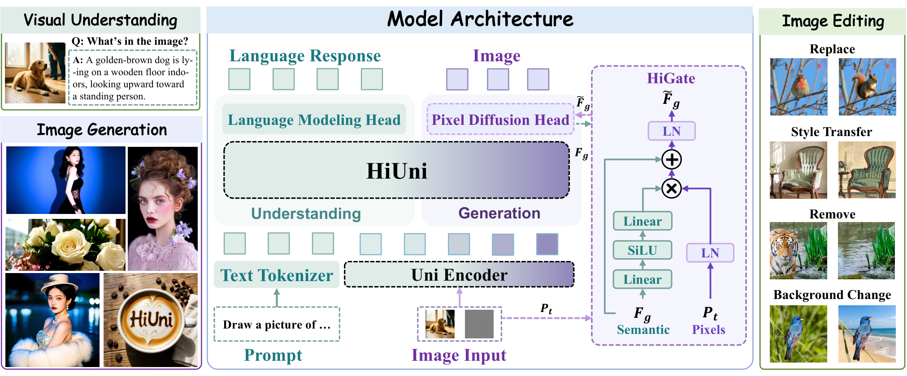

<div align="center">


</div>

<div align="center">
  <h1 style="font-size:3em; line-height:1.1; margin:0"><span style="background:linear-gradient(90deg,#2F8077 0%,#4F75B8 50%,#7457B8 100%);background-clip:text;-webkit-background-clip:text;color:transparent">HiUni</span>: Harmonizing Understanding and Generation in Shared Visual Space</h1>
  <p>
    <a href="https://ernie-research.github.io/HiUni/"></a>
    <a href="https://arxiv.org/abs/2611.26107"></a>
    <a href="https://huggingface.co/ernie-research/HiUni"></a>
  </p>
</div>

HiUni shares the same visual encoder and dense backbone across understanding, generation, and editing. Language understanding is handled by a language modeling head, while image synthesis is performed by a *Pixel Diffusion Head*. To bridge semantic representations and pixel-level details, *HiGate* provides a lightweight residual pathway that supplies local spatial cues weakened by visual compression.

<div align="center">



</div>

## ✨ Highlights

- **One Shared Visual Space** for understanding, generation and editing, with only the output heads task-specific.
- **Strong Understanding** on par with an understanding-only model of the same architecture.
- **VAE-Free Pixel Generation** up to 2048², with HiGate supplying the fine spatial detail lost in patch merging.
- **Small Model** with a 4B backbone and only 0.9B generation-specific parameters.


## 📰 News

- **[2026-11]** The [HiUni paper](https://arxiv.org/abs/2611.26107) is available on arXiv.
- **[2026-11]** We release the HiUni code: Megatron training (full fine-tuning and LoRA),
  Megatron and transformers inference, and Megatron <-> HF checkpoint conversion.

## 📘 User guide

- [`hf_inference/README.md`](hf_inference/README.md): all inference flags, batch input
  formats, Python API and sampling settings.
- [`recipe/transfusion/README.md`](recipe/transfusion/README.md): training configs, hot
  start, LoRA, data conversion, Megatron inference, benchmark scripts and checkpoint
  conversion.
- [Project page](https://ernie-research.github.io/HiUni/): method, results and ablations.

## 🧭 Contents

- [Highlights](#-highlights)
- [News](#-news)
- [User guide](#-user-guide)
- [Models](#-models)
- [Quick start](#-quick-start)
  - [Inference](#inference)
  - [DiffSynth-Studio and vLLM-Omni](#diffsynth-studio-and-vllm-omni)
  - [Train](#train)
- [Showcase](#-showcase)
- [Citation](#-citation)
- [Acknowledgements](#-acknowledgements)

## 📦 Models

| Model | Hugging Face | Description |
| --- | --- | --- |
| HiUni (HF) | [ernie-research/HiUni](https://huggingface.co/ernie-research/HiUni) | Primary release in transformers format (`trust_remote_code`), for inference |
| HiUni Base (HF) | [HiUni-Base](https://huggingface.co/ernie-research/HiUni/tree/main/HiUni-Base) | Trained without synthetic data |
| HiUni (Megatron) | [Megatron/HiUni](https://huggingface.co/ernie-research/HiUni/tree/main/Megatron/HiUni) | Model-only Megatron torch_dist format, for training and Megatron inference |
| HiUni Base (Megatron) | [Megatron/HiUni-Base](https://huggingface.co/ernie-research/HiUni/tree/main/Megatron/HiUni-Base) | Trained without synthetic data |
| Qwen3-VL-4B-Instruct | [Qwen/Qwen3-VL-4B-Instruct](https://huggingface.co/Qwen/Qwen3-VL-4B-Instruct) | Tokenizer and processor used by training |

The recommended generation resolution for HiUni Base is 1024 x 1024.

Put the selected checkpoints under `checkpoints/pixel_dit_hf`,
`checkpoints/pixel_dit_megatron` and `checkpoints/Qwen3-VL-4B-Instruct`; the scripts below
default to these paths.

## ⚡ Quick start

### Inference

Environment (Python 3.10+, any CUDA GPU; text-to-image at 2048² needs about 13 GB):

```bash
python -m venv .venv && source .venv/bin/activate
pip install -r hf_inference/requirements.txt
export PYTHONPATH="$PWD:${PYTHONPATH:-}"
```

Inference scripts. `MODEL` defaults to `./checkpoints/pixel_dit_hf`:

```bash
# Text-to-image (2048², 25 steps, CFG 4) -> ./outputs/hf_t2i
PROMPT="A red fox in fresh snow." bash hf_inference/scripts/run_hf_t2i.sh

# Image editing -> ./outputs/hf_edit
IMAGE=input.jpg PROMPT="Make the sky purple." bash hf_inference/scripts/run_hf_edit.sh

# Image understanding
IMAGE=cat.jpg PROMPT="Describe the image." bash hf_inference/scripts/run_hf_understand.sh

# Text chat
PROMPT="Explain flow matching briefly." bash hf_inference/scripts/run_hf_chat.sh

# Batch mode: jsonl with {"id", "prompt"} per line, sharded over 8 GPUs
DATA_PATH=prompts.jsonl NPROC=8 bash hf_inference/scripts/run_hf_t2i.sh
```

Sampling options (`STEPS`, `CFG`, `SHIFT`, `HEIGHT`, `WIDTH`, `SEED`, ...) are environment
variables of the same scripts; see [`hf_inference/README.md`](hf_inference/README.md).

### DiffSynth-Studio and vLLM-Omni

HiUni also runs natively in [DiffSynth-Studio](https://github.com/modelscope/DiffSynth-Studio)
and [vLLM-Omni](https://github.com/vllm-project/vllm-omni). In both, one checkpoint
(`ernie-research/HiUni`) serves image understanding, generation and editing. Support is on
the `hiuni` branch of our forks until it is merged upstream.

#### DiffSynth-Studio

```bash
git clone -b hiuni https://github.com/591582523h/DiffSynth-Studio.git
cd DiffSynth-Studio && pip install -e .
```

```python
import torch
from PIL import Image
from diffsynth.pipelines.hiuni import HiUniPipeline, ModelConfig

repo = "ernie-research/HiUni"
pipe = HiUniPipeline.from_pretrained(
    torch_dtype=torch.bfloat16,
    device="cuda",
    model_configs=[ModelConfig(model_id=repo, origin_file_pattern="model-*.safetensors", download_source="huggingface")],
    tokenizer_config=ModelConfig(model_id=repo, origin_file_pattern="tokenizer*.json", download_source="huggingface"),
    processor_config=ModelConfig(model_id=repo, origin_file_pattern="preprocessor_config.json", download_source="huggingface"),
)

# Text-to-image
image = pipe("A red fox in fresh snow.", height=2048, width=2048, seed=42, num_inference_steps=25, cfg_scale=4.0, shift=4.0)
image.save("hiuni_t2i.jpg")

# Image editing: passing edit_image switches to editing mode
edit_image = Image.open("input.jpg").convert("RGB")
pipe("Make the sky purple.", edit_image=edit_image, seed=42).save("hiuni_edit.jpg")

# Image understanding and text chat
print(pipe.chat("Describe the image.", images=edit_image))
print(pipe.chat("Explain flow matching briefly.", think_mode="empty"))
```

All parameters are listed in
[`docs/en/Model_Details/HiUni.md`](https://github.com/591582523h/DiffSynth-Studio/blob/hiuni/docs/en/Model_Details/HiUni.md).

#### vLLM-Omni

```bash
uv pip install vllm==0.34.0 --torch-backend=cu130
git clone -b hiuni https://github.com/591582523h/vllm-omni.git
cd vllm-omni && uv pip install -e .
```

See the vLLM-Omni
[CUDA installation guide](https://github.com/591582523h/vllm-omni/blob/hiuni/docs/getting_started/installation/gpu/cuda.inc.md)
for the cuDNN runtime setup. The checkpoint is detected from its `config.json`, so no
model class or deploy config is needed.

vLLM-Omni downloads the whole Hugging Face repo before loading, and this repo also holds
the HiUni Base and Megatron checkpoints. Download only the HiUni checkpoint first and pass
the local directory as the model:

```bash
hf download ernie-research/HiUni --exclude "HiUni-Base/*" "Megatron/*" --local-dir ./HiUni
```

Offline, with the shared vLLM-Omni examples:

```bash
python examples/offline_inference/text_to_image/text_to_image.py \
    --model ./HiUni --prompt "A red fox in fresh snow." \
    --height 1024 --width 1024 --num-inference-steps 25 --seed 42 --cfg-scale 4.0 \
    --output hiuni_t2i.png

python examples/offline_inference/image_to_image/image_edit.py \
    --model ./HiUni --image input.jpg --prompt "Make the sky purple." \
    --num-inference-steps 25 --seed 42 --cfg-scale 4.0 --output hiuni_edit.png
```

Online, with an OpenAI-compatible server:

```bash
vllm serve ./HiUni --omni --port 8091

# Image understanding (omit the image_url item for text chat)
curl -s http://localhost:8091/v1/chat/completions -H "Content-Type: application/json" -d '{
  "messages": [{"role": "user", "content": [
    {"type": "image_url", "image_url": {"url": "https://example.com/photo.jpg"}},
    {"type": "text", "text": "Describe the image."}]}],
  "modalities": ["text"], "think_mode": "empty", "max_new_tokens": 256
}'

# Text-to-image
curl -s http://localhost:8091/v1/images/generations -H "Content-Type: application/json" -d '{
  "prompt": "A red fox in fresh snow.", "size": "1024x1024",
  "num_inference_steps": 25, "seed": 42, "true_cfg_scale": 4.0
}'

# Image editing (output keeps the input size unless "size" is given)
curl -s http://localhost:8091/v1/images/edits \
  -F image=@input.jpg -F prompt="Make the sky purple." -F num_inference_steps=25 -F seed=42
```

The image endpoints return the image as base64 in `data[0].b64_json`. Request routing and
all request parameters are documented in the
[vLLM-Omni HiUni recipe](https://github.com/591582523h/vllm-omni/blob/hiuni/recipes/Baidu/HiUni.md).

### Train

#### Environment

Training uses Megatron and needs Hopper (SM90) or Blackwell (SM100) GPUs for FlashMask.

```bash
# 1. NeMo container (torch 2.9, CUDA 13.0, Transformer Engine, Apex, flash-attn)
docker run --gpus all --ipc=host --ulimit memlock=-1 --ulimit stack=67108864 \
    -v $PWD:/workspace/hiuni -w /workspace/hiuni -it nvcr.io/nvidia/nemo:25.11 bash

# 2. Python packages
pip install -r requirements.txt

# 3. FlashMask (cloned into 3rdparty/FlashMask at the verified commit)
bash recipe/transfusion/build_env.sh
python -c "from megatron.core.transformer import attention as a; print('HAS_FLASHMASK', a.HAS_FLASHMASK)"
```

The vendored Megatron-Bridge and Megatron-LM in `3rdparty/` must be used instead of the
container's copies; the launch scripts put them on `PYTHONPATH`.

#### Dataset

Write one JSONL per task, then convert it to Energon shards. Images can be local paths
(relative to the JSONL file) or `http(s)://` URLs.

Text-to-image:

```jsonl
{"data_id": "0001", "image": "images/0001.jpg", "caption": "A red fox in fresh snow."}
```

Image editing (source image, instruction, target image):

```jsonl
{"data_id": "e001", "image_info": [{"image": "images/e001_src.jpg", "matched_text_index": 0}, {"image": "images/e001_dst.jpg", "matched_text_index": 1}], "text_list": [{"text": "Make the fox black."}], "order": {"type": ["image", "text", "image"], "index": [0, 0, 1], "mask": [1, 1, 0]}}
```

Image understanding (`tag: "mask"` = prompt, not trained; `"no_mask"` = answer, trained;
the image is inserted before `text_list[matched_text_index]`):

```jsonl
{"data_id": "u001", "image_info": [{"image": "images/u001.jpg", "matched_text_index": 0}], "text_list": [{"text": "Describe the image.", "tag": "mask"}, {"text": "A red fox standing in fresh snow.", "tag": "no_mask"}]}
```

```bash
bash recipe/transfusion/data/run_local_job_t2i.sh --input t2i.jsonl --output-dir ./output/my_t2i
bash recipe/transfusion/data/run_local_job_i2i.sh --input edit.jsonl --output-dir ./output/my_i2i
python recipe/transfusion/data/convert_und.py --input-jsonl und.jsonl --output-dir ./output/my_und
# convert_und.py writes plain WebDataset shards; index them for Energon.
# Answers: split "1,0,0", create dataset.yaml "y", sample type "11" (Crude sample).
energon prepare ./output/my_und
```

Training reads three streams, each a blend file in `recipe/transfusion/probs/`. Point
the `path:` entries at your shards (put editing data in the generation blend next to
T2I) and set how many samples per global batch come from each stream:

```yaml
# recipe/transfusion/probs/test_t2i.yaml
__module__: megatron.energon
__class__: MetadatasetV2
splits:
  train:
    blend:
      - weight: 0.7
        path: ./output/my_t2i
      - weight: 0.3
        path: ./output/my_i2i
```

```yaml
# in the training config
dataset:
  data_streams:
    text: ./recipe/transfusion/probs/test_text.yaml
    understanding: ./recipe/transfusion/probs/test_i2t.yaml
    generation: ./recipe/transfusion/probs/test_t2i.yaml
  batch_schedule:            # must sum to the global batch size
    text: 32
    understanding: 64
    generation: 160
```

A stream you have no data for can be removed from both `data_streams` and
`batch_schedule`.

#### Launch

Fine-tune from the HiUni release checkpoint (`checkpoints/pixel_dit_megatron`):

```bash
# Full fine-tuning; checkpoints go to ./output/pixel_dit_sft_hotstart
CONFIG_FILE=recipe/transfusion/conf/transfusion_qwen3_vl_4b_pixel_dit_sft_hotstart.yaml \
    bash recipe/transfusion/run_transfusion_pretrain.sh

# LoRA; checkpoints go to ./output/pixel_dit_lora
CONFIG_FILE=recipe/transfusion/conf/transfusion_qwen3_vl_4b_pixel_dit_lora.yaml \
    bash recipe/transfusion/run_transfusion_pretrain.sh
# merge the adapters before inference or HF export
python recipe/transfusion/scripts/merge_lora_checkpoint.py --base checkpoints/pixel_dit_megatron \
    --lora output/pixel_dit_lora --output output/pixel_dit_lora_merged
```

Extra arguments override the config, e.g. `optimizer.lr=5e-6 train.train_iters=4000`. For
multiple nodes, set `NNODES`, `NODE_RANK`, `MASTER_ADDR`, `MASTER_PORT` (and
`GPUS_PER_NODE`) on every node. Relaunching the same command resumes from the last
checkpoint. To export a trained checkpoint to HF format, see
[`recipe/transfusion/README.md`](recipe/transfusion/README.md).

## 🖼️ Showcase


## 📚 Citation

```bibtex
@article{hu2026hiuni,
  title         = {HiUni: Harmonizing Understanding and Generation in Shared Visual Space},
  author        = {Hu, Jiahao and Du, Jingdong and Zhang, Yichen and Song, Yi and
                   Zhang, Zhenyu and Niu, Jiaxin and Li, Ruihang and Hao, Xiangzhao and
                   Zhang, Yiqian and Huang, Yong and Zhang, Zefeng and Gu, Zheyuan and
                   Wang, Shuohuan},
  journal       = {arXiv preprint arXiv:2611.26107},
  year          = {2026},
  eprint        = {2611.26107},
  archivePrefix = {arXiv},
  primaryClass  = {cs.CV},
  url           = {https://arxiv.org/abs/2611.26107}
}
```

## 📄 Acknowledgements

We thank the [Qwen3-VL](https://github.com/QwenLM/Qwen3-VL), [Megatron-Bridge](https://github.com/NVIDIA-NeMo/Megatron-Bridge), [Megatron-LM](https://github.com/NVIDIA/Megatron-LM), [NeMo](https://github.com/NVIDIA-NeMo) and [FlashMask](https://github.com/PaddlePaddle/FlashMask) teams.
