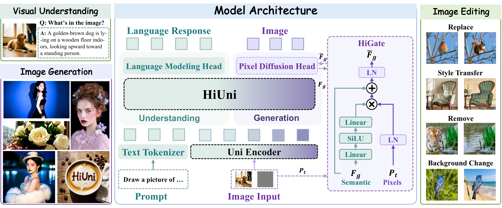

<div align="center">


</div>

<div align="center">
  <h1 style="font-size:3em; line-height:1.1; margin:0"><span style="background:linear-gradient(90deg,#2F8077 0%,#4F75B8 50%,#7457B8 100%);background-clip:text;-webkit-background-clip:text;color:transparent">HiUni</span>：在共享视觉空间中统一理解与生成</h1>
  <p><a href="README.md">English</a> · <strong>简体中文</strong></p>
  <p>
    <a href="docs/index.html"></a>
    <a href="#citation"></a>
    <a href="#models"></a>
  </p>
</div>

HiUni 是一个从 Qwen3-VL-4B-Instruct 初始化的统一多模态模型。理解、文生图和图像编辑共用同一个语言对齐的 ViT 和同一个稠密主干。生成专用的部分只有两个：直接解码 RGB patch 的 Pixel Diffusion Head，以及把像素细节送入该 head 的轻量 HiGate 通路。

<div align="center">



</div>

<a id="news"></a>

## 📰 新闻

- **[2026-10]** 发布 HiUni 代码：Megatron 训练（全量微调和 LoRA）、Megatron 与 transformers
  推理，以及 Megatron <-> HF 权重转换。模型权重和论文即将发布。

  亮点：

  - **共享视觉空间：** 生成复用 VLM 的 ViT 和主干，同时在七项基准上保持
    Qwen3-VL-4B-Instruct 级别的理解能力（平均分 75.56，而起始模型为 75.61）。
  - **像素空间生成**，最高 2048²，4B 主干 + 0.9B 生成专用参数。
  - **文字渲染：** Qwen-Image-Bench 中文总分在统一模型中最高（47.98）；LongText 中文 0.963，
    英文 0.954。
  - **图像编辑：** ImgEdit 3.66，GEdit 中文 6.70 / 英文 6.81（由 GPT-5.2 评判）。
  - **一个权重**同时支持文生图、编辑、对话和图像理解。

<a id="user-guide"></a>

## 📘 使用指南

- [`hf_inference/README.md`](hf_inference/README.md)：全部推理参数、批量输入格式、Python API
  和采样设置。
- [`recipe/transfusion/README.md`](recipe/transfusion/README.md)：训练配置、热启动、LoRA、
  数据转换、Megatron 推理、评测脚本和权重转换。
- [项目主页](docs/index.html)：方法、结果和消融实验。

## 🧭 目录

- [新闻](#news)
- [使用指南](#user-guide)
- [模型](#models)
- [快速开始](#quick-start)
  - [推理](#inference)
  - [训练](#train)
- [效果展示](#showcase)
- [引用](#citation)
- [致谢](#acknowledgements)

<a id="models"></a>

## 📦 模型

| 模型 | Hugging Face | 说明 |
| --- | --- | --- |
| HiUni (HF) | 即将发布 | transformers 格式（`trust_remote_code`），用于推理 |
| HiUni (Megatron) | 即将发布 | Megatron torch_dist 格式，用于训练和 Megatron 推理 |
| Qwen3-VL-4B-Instruct | [Qwen/Qwen3-VL-4B-Instruct](https://huggingface.co/Qwen/Qwen3-VL-4B-Instruct) | 训练使用的 tokenizer 和 processor |

分别放到 `checkpoints/pixel_dit_hf`、`checkpoints/pixel_dit_megatron` 和
`checkpoints/Qwen3-VL-4B-Instruct`，下面的脚本默认读取这些路径。

<a id="quick-start"></a>

## ⚡ 快速开始

<a id="inference"></a>

### 推理

环境（Python 3.10+，任意 CUDA GPU；2048² 文生图约需 13 GB 显存）：

```bash
python -m venv .venv && source .venv/bin/activate
pip install -r hf_inference/requirements.txt
export PYTHONPATH="$PWD:${PYTHONPATH:-}"
```

推理脚本，`MODEL` 默认为 `./checkpoints/pixel_dit_hf`：

```bash
# 文生图（2048²，25 步，CFG 4）-> ./outputs/hf_t2i
PROMPT="A red fox in fresh snow." bash hf_inference/scripts/run_hf_t2i.sh

# 图像编辑 -> ./outputs/hf_edit
IMAGE=input.jpg PROMPT="Make the sky purple." bash hf_inference/scripts/run_hf_edit.sh

# 图像理解
IMAGE=cat.jpg PROMPT="Describe the image." bash hf_inference/scripts/run_hf_understand.sh

# 纯文本对话
PROMPT="Explain flow matching briefly." bash hf_inference/scripts/run_hf_chat.sh

# 批量模式：jsonl 每行一个 {"id", "prompt"}，分到 8 张 GPU
DATA_PATH=prompts.jsonl NPROC=8 bash hf_inference/scripts/run_hf_t2i.sh
```

采样参数（`STEPS`、`CFG`、`SHIFT`、`HEIGHT`、`WIDTH`、`SEED` 等）都是这些脚本的环境变量，
详见 [`hf_inference/README.md`](hf_inference/README.md)。

<a id="train"></a>

### 训练

#### 环境

训练基于 Megatron，FlashMask 需要 Hopper（SM90）或 Blackwell（SM100）GPU。

```bash
# 1. NeMo 容器（torch 2.9、CUDA 13.0、Transformer Engine、Apex、flash-attn）
docker run --gpus all --ipc=host --ulimit memlock=-1 --ulimit stack=67108864 \
    -v $PWD:/workspace/hiuni -w /workspace/hiuni -it nvcr.io/nvidia/nemo:25.11 bash

# 2. Python 依赖
pip install -r requirements.txt

# 3. FlashMask（按验证过的 commit 克隆到 3rdparty/FlashMask）
bash recipe/transfusion/build_env.sh
python -c "from megatron.core.transformer import attention as a; print('HAS_FLASHMASK', a.HAS_FLASHMASK)"
```

必须使用 `3rdparty/` 下自带的 Megatron-Bridge 和 Megatron-LM，而不是容器里预装的版本；
启动脚本会自动把它们加到 `PYTHONPATH`。

#### 数据集

每个任务写一个 JSONL，再转换成 Energon 分片。图片可以是本地路径（相对于 JSONL 文件所在
目录）或 `http(s)://` URL。

文生图：

```jsonl
{"data_id": "0001", "image": "images/0001.jpg", "caption": "A red fox in fresh snow."}
```

图像编辑（原图、指令、目标图）：

```jsonl
{"data_id": "e001", "image_info": [{"image": "images/e001_src.jpg", "matched_text_index": 0}, {"image": "images/e001_dst.jpg", "matched_text_index": 1}], "text_list": [{"text": "Make the fox black."}], "order": {"type": ["image", "text", "image"], "index": [0, 0, 1], "mask": [1, 1, 0]}}
```

图像理解（`tag: "mask"` 为提问，不参与训练；`"no_mask"` 为回答，参与训练；图片插入到
`text_list[matched_text_index]` 之前）：

```jsonl
{"data_id": "u001", "image_info": [{"image": "images/u001.jpg", "matched_text_index": 0}], "text_list": [{"text": "Describe the image.", "tag": "mask"}, {"text": "A red fox standing in fresh snow.", "tag": "no_mask"}]}
```

```bash
bash recipe/transfusion/data/run_local_job_t2i.sh --input t2i.jsonl --output-dir ./output/my_t2i
bash recipe/transfusion/data/run_local_job_i2i.sh --input edit.jsonl --output-dir ./output/my_i2i
python recipe/transfusion/data/convert_und.py --input-jsonl und.jsonl --output-dir ./output/my_und
# convert_und.py 只写出普通 WebDataset 分片，还需要为 Energon 建索引。
# 交互时依次输入：split "1,0,0"，创建 dataset.yaml "y"，样本类型 "11"（Crude sample）。
energon prepare ./output/my_und
```

训练读取三路数据流，每路对应 `recipe/transfusion/probs/` 下的一个 blend 文件。把其中的
`path:` 指向你的分片（编辑数据和文生图数据一起放在 generation 的 blend 里），并设置每个
global batch 中各数据流的样本数：

```yaml
# recipe/transfusion/probs/test_t2i.yaml
__module__: megatron.energon
__class__: MetadatasetV2
splits:
  train:
    blend:
      - weight: 0.7
        path: ./output/my_t2i
      - weight: 0.3
        path: ./output/my_i2i
```

```yaml
# 训练配置中
dataset:
  data_streams:
    text: ./recipe/transfusion/probs/test_text.yaml
    understanding: ./recipe/transfusion/probs/test_i2t.yaml
    generation: ./recipe/transfusion/probs/test_t2i.yaml
  batch_schedule:            # 之和必须等于 global batch size
    text: 32
    understanding: 64
    generation: 160
```

没有数据的数据流，可以同时从 `data_streams` 和 `batch_schedule` 中删掉。

#### 启动训练

从 HiUni 发布权重（`checkpoints/pixel_dit_megatron`）开始微调：

```bash
# 全量微调；checkpoint 保存到 ./output/pixel_dit_sft_hotstart
CONFIG_FILE=recipe/transfusion/conf/transfusion_qwen3_vl_4b_pixel_dit_sft_hotstart.yaml \
    bash recipe/transfusion/run_transfusion_pretrain.sh

# LoRA；checkpoint 保存到 ./output/pixel_dit_lora
CONFIG_FILE=recipe/transfusion/conf/transfusion_qwen3_vl_4b_pixel_dit_lora.yaml \
    bash recipe/transfusion/run_transfusion_pretrain.sh
# 推理或导出 HF 之前，先把 adapter 合并进基础权重
python recipe/transfusion/scripts/merge_lora_checkpoint.py --base checkpoints/pixel_dit_megatron \
    --lora output/pixel_dit_lora --output output/pixel_dit_lora_merged
```

额外参数会覆盖配置，例如 `optimizer.lr=5e-6 train.train_iters=4000`。多机训练时，在每个
节点上设置 `NNODES`、`NODE_RANK`、`MASTER_ADDR`、`MASTER_PORT`（以及 `GPUS_PER_NODE`）。
重新执行同一条命令会从最近的 checkpoint 续训。把训练好的权重导出为 HF 格式，见
[`recipe/transfusion/README.md`](recipe/transfusion/README.md)。

<a id="showcase"></a>

## 🖼️ 效果展示


<a id="citation"></a>

## 📚 引用

```bibtex
@misc{hiuni2026,
  title  = {HiUni: Harmonizing Understanding and Generation in Shared Visual Space},
  author = {ERNIE Team},
  year   = {2026},
  note   = {Preprint}
}
```

基础视觉语言模型使用 [Qwen3-VL](https://github.com/QwenLM/Qwen3-VL)，使用 HiUni 时请同时引用该项目。

<a id="acknowledgements"></a>

## 📄 致谢

感谢 [Qwen3-VL](https://github.com/QwenLM/Qwen3-VL)、Megatron-Bridge、Megatron-LM、NeMo 和 FlashMask 团队。
